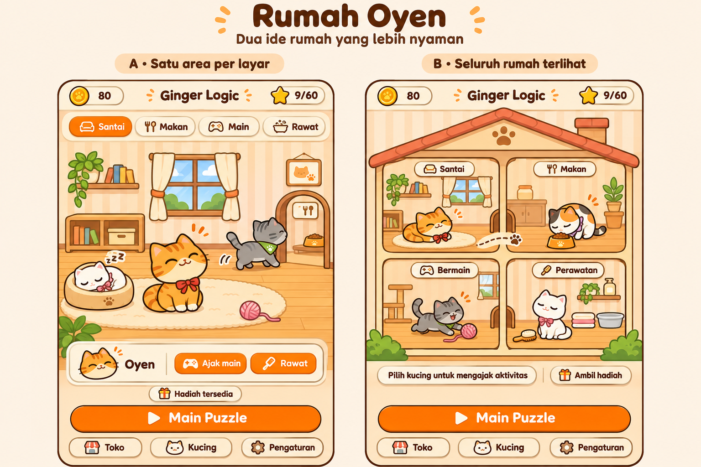

# 🐱 Ginger Logic

**Oyen won't listen. You do the thinking.**

Game puzzle mobile tentang kucing oren yang bergerak sendiri mengikuti aturan tetap. Pemain mengatur ikan, air dan kardus agar Oyen sampai ke mangkuk tanpa memecahkan vas Ibu.

## Arah baru

Pada 8 November 2026, pemilik repo memilih perombakan seluruh visual mengikuti **konsep A — satu area per layar**, termasuk bentuk kucing, furnitur, UI dan layar puzzle. Rumah v2 sudah berjalan dengan Beranda Santai, Area Makan dan Bermain berilustrasi, aktivitas otomatis serta ajakan pemain. Area dan layar lainnya diselesaikan bertahap mengikuti roadmap.



- [Roadmap baru, berikutnya langkah 8](docs/ROADMAP.md)
- [Spesifikasi dan mockup desain v2 — disetujui](docs/design-v2/README.md)
- [Brief arah desain](docs/design-brief/rumah-oyen-area/ARAH_DESAIN.md)
- [Keputusan aktif](docs/DESIGN_NOTES.md)

Screenshot, ekspor desain dan rencana visual lama sudah dibersihkan dari acuan aktif. Gambar dokumentasi serta materi Play Store akan dibuat ulang setelah tampilan baru selesai. Persiapan release tetap menjadi tahap akhir roadmap.

## Fondasi game yang sudah berjalan

- Dua babak, 20 level, tiga bintang per level, solver dan putar ulang langkah demi langkah.
- Petunjuk, koin, bonus harian dan iklan berhadiah pilihan pemain.
- Rumah, koleksi sembilan kucing, barang, aksesoris dan kebutuhan; menjadi fondasi migrasi ke desain beberapa area.
- Progres tersimpan di perangkat; bahasa Inggris, Indonesia, Portugis Brasil dan Rusia.
- Flutter + Flame, Android portrait. Package ID `com.gingerlogic.app`.

Aturan dan data puzzle tetap mengacu [GDD](docs/GDD.md), `assets/levels/chapter1-2.json` dan [simulator acuan](docs/reference/oyen_simulator.py). Pergantian nomor roadmap tidak mereset progres pemain.

## Menjalankan dan memeriksa

Gunakan Flutter yang memenuhi `pubspec.yaml`.

```sh
flutter pub get
flutter run
flutter analyze
flutter test
```

Galeri komponen tersedia melalui `flutter run --route /galeri`.
Galeri aset desain v2 (sembilan karakter, animasi, aksesoris, barang, empat area) tersedia melalui `flutter run --route /galeri/aset-v2`; [render dan hasil pemeriksaan](docs/design-v2/assets/REVIEW.md).

Galeri fondasi UI v2 tersedia melalui `flutter run --route /galeri/ui-v2`; [render empat bahasa dan pemeriksaan komponen](docs/design-v2/ui/REVIEW.md).

Area Makan v2 tersedia dari tab Makan: mangkuk interaktif, ajakan/otomatis,
antrean dan jatah per kucing. [Render dan verifikasi langkah 6](docs/design-v2/dining/REVIEW.md).

Area Bermain v2: satu mainan bergantian, ajakan/otomatis, antrean dan cooldown.
[Render dan verifikasi langkah 7](docs/design-v2/play/REVIEW.md).

Generator screenshot dan merek di `test/screenshots/` masih mengikuti runtime yang lama; perbarui sesuai desain baru sebelum membuat materi final. Screenshot baru dibuat pada langkah 14 roadmap, bukan mengambil kembali gambar lama.

## Struktur

| Folder | Isi |
| --- | --- |
| `lib/game/sim/` | Simulator dan solver Dart murni |
| `lib/game/model/` | Sesi level, progres, rumah, kebutuhan dan rutinitas |
| `lib/game/render/` | Renderer runtime; diganti bertahap mengikuti desain baru |
| `lib/screens/` | Rumah, Toko, peta, level, hasil, replay dan Pengaturan |
| `lib/widgets/`, `lib/theme/` | Komponen dan token UI |
| `lib/app/` | Router, penyimpanan, suara dan iklan |
| `docs/design-brief/rumah-oyen-area/` | Acuan visual baru dan brief |
| `docs/store/` | Listing, privasi dan panduan release yang dipertahankan |

Rincian kode dan alur kerja ada di [CLAUDE.md](CLAUDE.md). [Baseline performa 8 November](docs/performance-room-2026-11-08.md) berlaku untuk visual sebelumnya, bukan kelulusan desain baru.

## Kredit

Font Fredoka dan Nunito memakai SIL Open Font License (`assets/fonts/`). Kredit suara ada di `assets/audio/LICENSE-sfx.txt`. Sumber dan lisensi aset visual baru dicatat bersama paket asetnya.
