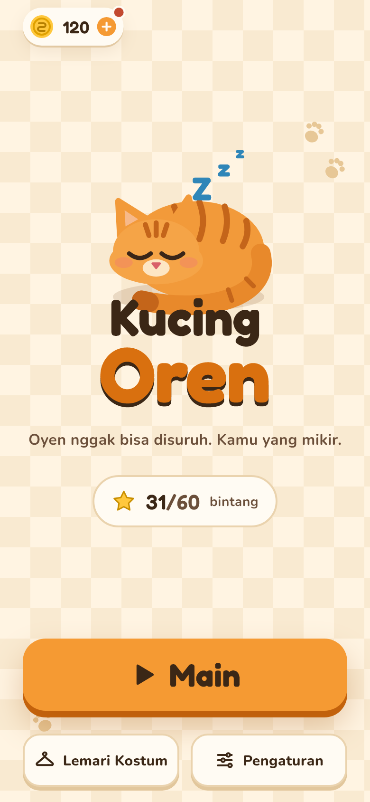
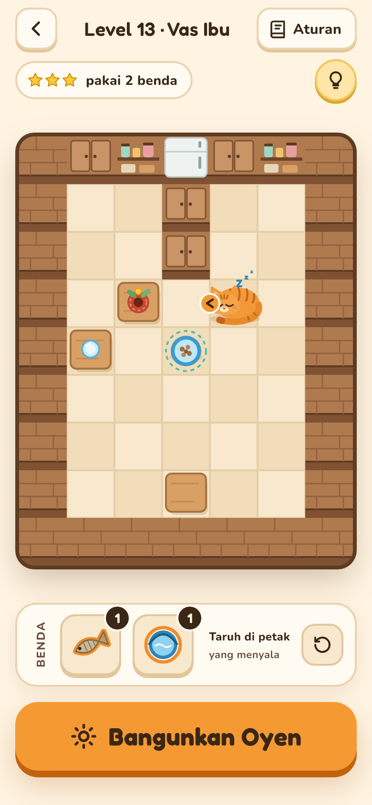
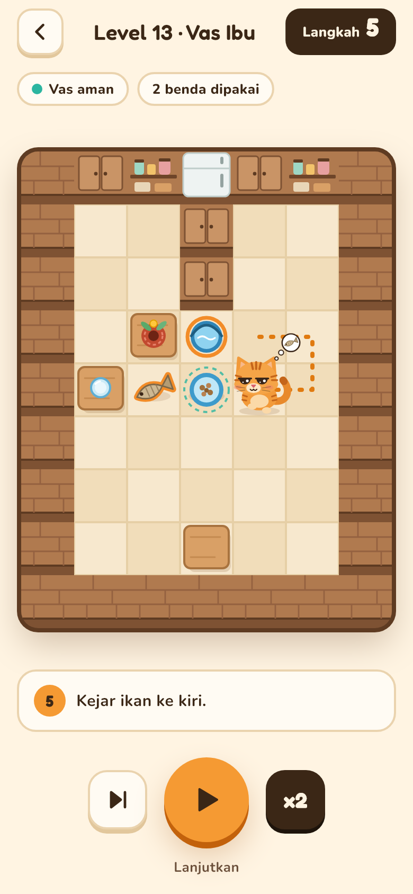
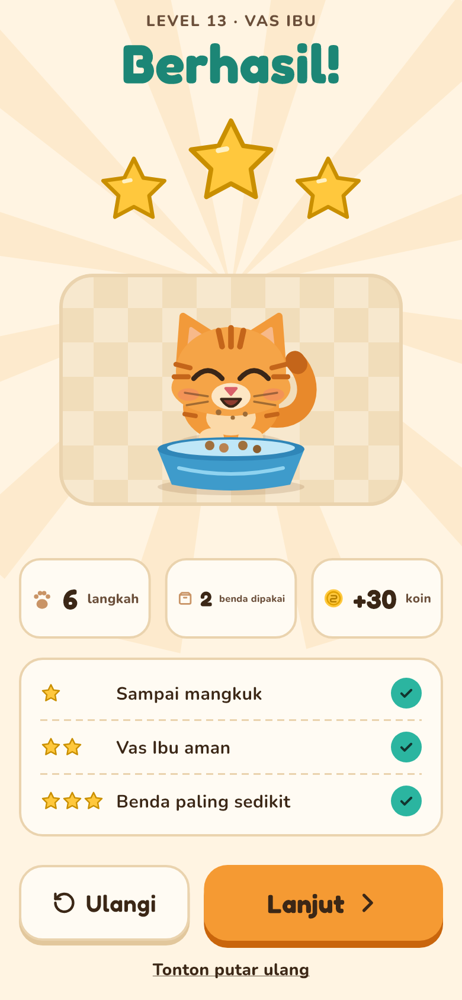
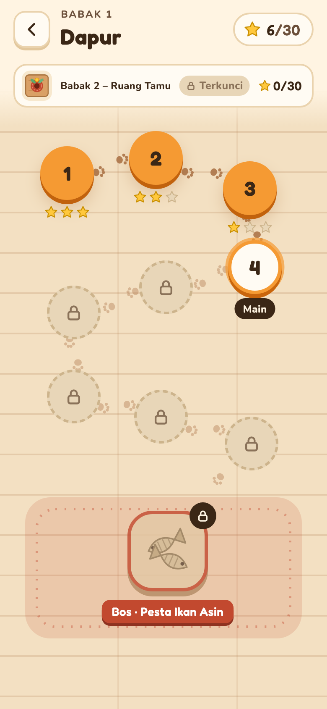
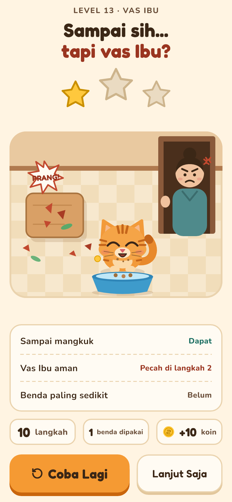
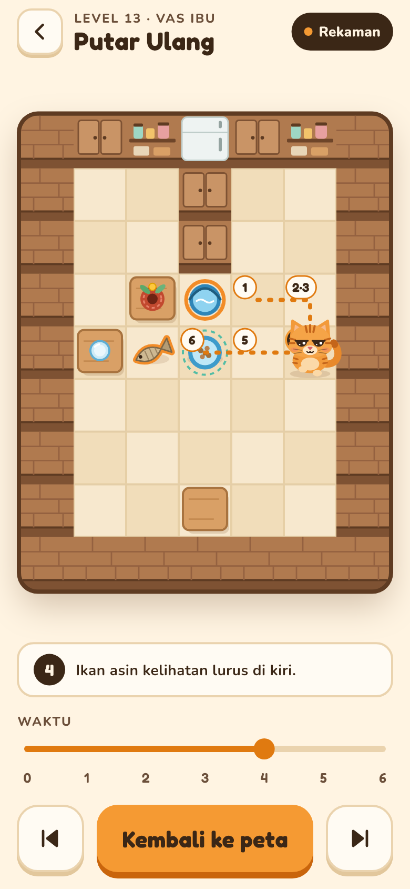
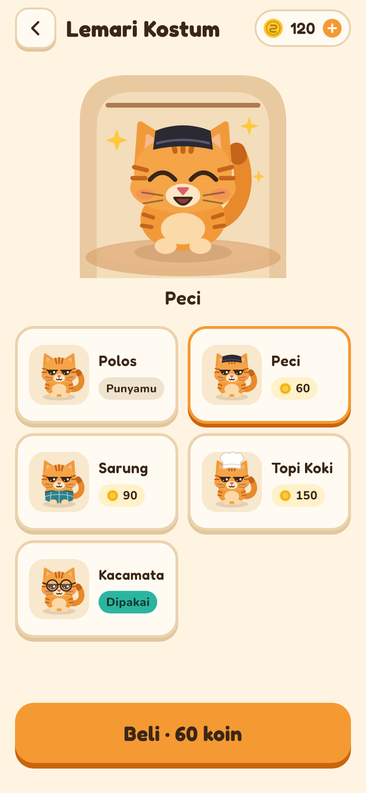

<div align="center">

# 🐱 Ginger Logic

**Oyen won't listen. You do the thinking.**

Game puzzle mobile tentang kucing oren yang cuma mau ke mangkuknya kalau jalannya kamu atur.







</div>

## Tentang game

Kamu tidak mengendalikan Oyen. Selagi Oyen tidur, kamu menaruh **ikan asin**, **ember air**, dan **kardus** di papan 7×9. Begitu dibangunkan, Oyen bergerak sendiri mengikuti aturan tetap. Tantangannya: menebak tingkah Oyen supaya ia sampai ke mangkuk makan, jangan sampai menjatuhkan vas Ibu, dan pakai benda sesedikit mungkin.

- **20 level** dalam dua babak: Babak 1 Dapur dan Babak 2 Ruang Tamu, masing-masing ditutup level bos.
- **3 bintang per level**: sampai mangkuk, vas Ibu aman, dan benda paling sedikit.
- **Putar ulang** langkah demi langkah untuk melihat di mana tebakanmu meleset.
- **Petunjuk** bertingkat yang dibuka dengan koin atau iklan, plus kartu aturan dan tutorial interaktif.
- **Lemari Kostum**: peci, sarung, topi koki, dan kacamata untuk Oyen.
- **Koin** dari bintang baru, bonus harian, dan iklan berhadiah.
- **Empat bahasa**: Inggris, Indonesia, Portugis Brasil, dan Rusia, dengan nada santai yang sama. Bahasa awal mengikuti HP; bisa diganti di **Pengaturan** (juga lihat tutorial lagi dan reset progres).

## Aturan Oyen

Setiap langkah, Oyen mengecek aturan dari atas ke bawah dan menjalankan aturan pertama yang cocok:

1. **Sudah di mangkuk** → menang.
2. **Sedang di kardus** → duduk 2 langkah, lalu kardus penyok dan Oyen lanjut.
3. **Ada barang di meja sebelahnya** → dijatuhkan. Gelas plastik aman, vas Ibu pecah.
4. **Melihat ikan** dalam garis lurus → menghadap ke ikan terdekat (seri: depan, searah jarum jam, berlawanan jarum jam, belakang).
5. **Petak di depan**: air → putar balik; tembok atau meja → berputar searah jarum jam; kardus → masuk dan duduk; ikan → maju dan makan; lantai atau mangkuk → maju.

Level gagal kalau Oyen mondar-mandir di keadaan yang sama atau lewat 80 langkah. Vas pecah tidak menggagalkan level, tapi bintang 2 dan 3 hilang. Detail lengkap ada di [docs/GDD.md](docs/GDD.md).

<div align="center">






</div>

## Menjalankan

Butuh Flutter 3.47 (Dart 3.13) dan perangkat atau emulator Android.

```sh
flutter pub get
flutter run
```

Galeri komponen dan sprite tidak punya tombol di dalam game; buka langsung lewat rute:

```sh
flutter run --route /galeri
```

## Test

```sh
flutter analyze
flutter test
```

Test mencakup simulasi dan solver (solusi ke-20 level harus menang tanpa memecahkan vas, dengan jumlah langkah yang sama dengan data), sesi level, layar, overflow di ukuran layar 360×640 sampai 412×915, dan teks 130%.

Potret layar seperti di atas dibuat dari test:

```sh
flutter test test/screenshots --dart-define=SCREENSHOTS=true
# hasil: build/screenshots/390x844/*.png
```

## Struktur

| Folder | Isi |
| --- | --- |
| `lib/game/sim/` | Simulasi dan solver Oyen, Dart murni tanpa Flutter |
| `lib/game/model/` | Sesi level, fase jalan, putar ulang, progres, petunjuk, kostum, hadiah |
| `lib/game/render/` | Gambar petak, papan, Oyen, dan ilustrasi lewat `Canvas` |
| `lib/game/` | `KucingGame` (Flame) dan komponen papan |
| `lib/screens/` | Beranda, peta babak, level, hasil, putar ulang, Lemari Kostum, Tambah Koin |
| `lib/widgets/`, `lib/theme/` | Komponen dasar dan token desain |
| `lib/app/` | Router, progres tersimpan, iklan berhadiah |
| `assets/levels/` | Data 20 level: peta, baki, target bintang, solusi |

Rincian API per folder ada di [CLAUDE.md](CLAUDE.md).

## Dokumen

- [docs/GDD.md](docs/GDD.md): desain game, aturan Oyen, elemen peta, dan tabel 20 level.
- [docs/ROADMAP.md](docs/ROADMAP.md): langkah pengerjaan dan statusnya.
- [docs/DESIGN_NOTES.md](docs/DESIGN_NOTES.md): keputusan saat desain, GDD, dan data level tidak cocok.
- [docs/reference/oyen_simulator.py](docs/reference/oyen_simulator.py): simulator dan solver acuan; logika Dart harus identik dengannya.

## Kredit

Font [Fredoka](https://fonts.google.com/specimen/Fredoka) dan [Nunito](https://fonts.google.com/specimen/Nunito) memakai SIL Open Font License (lisensinya ada di `assets/fonts/`).
