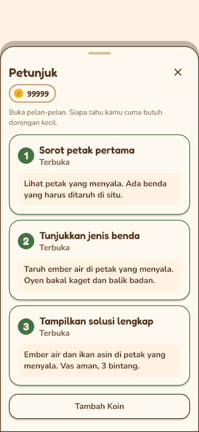
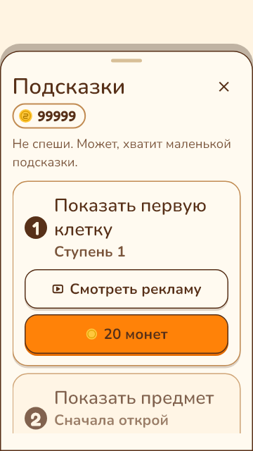
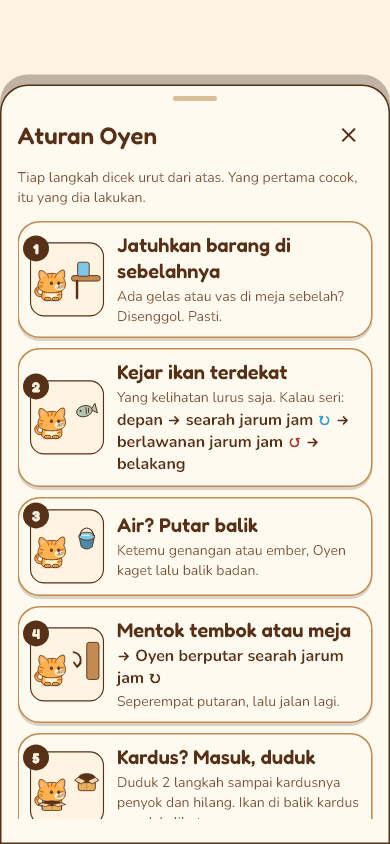
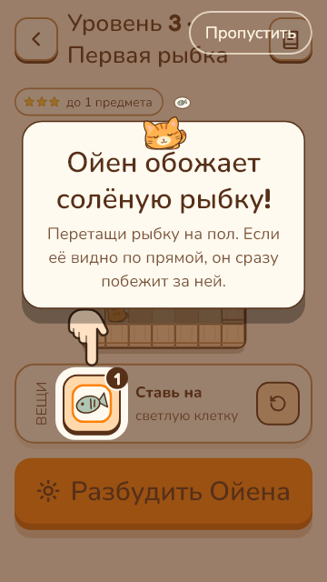
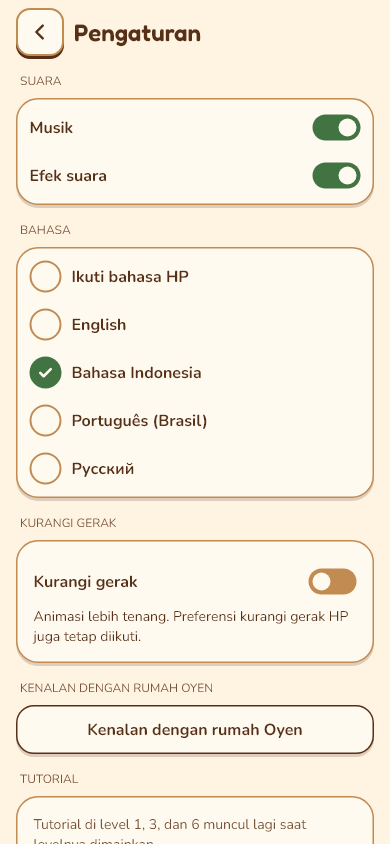
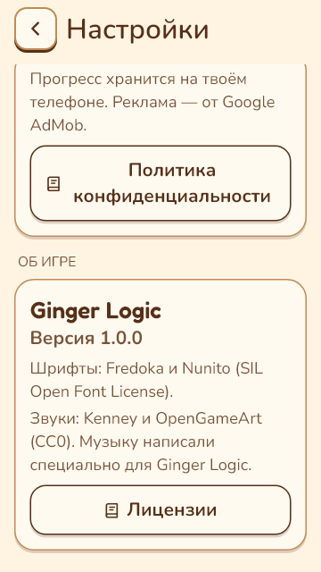

# Tutorial, petunjuk, koin dan Pengaturan v2

10 November 2026 · langkah 12 · implementasi pada `feat/design-v2-guidance-settings`.
Acuan: SPEC/SCREENS/VISUAL langkah 1 yang telah disetujui. Laporan ini adalah
bukti implementasi dan pemeriksaan sesi, bukan persetujuan visual pemilik repo
atau kelulusan uji HP.

## Perubahan pemain

- Tutorial 1/3/6 memakai rig Oyen rumah/puzzle. Sorotan tetap meneruskan input
  yang benar; Lewati memiliki target 48 dp. Kartu dipadatkan dan bisa digulir
  ketika ruang vertikal terbatas, tanpa mengecilkan teks.
- Lima kartu aturan memakai ilustrasi PuzzleArt/CatRig, ikon gembok dan urutan
  tetap. Seni lama tidak dipakai oleh sheet aturan pemain.
- Petunjuk/Koin memakai panel paper, outline cokelat, tombol v2 yang membungkus,
  judul dan saldo di baris berbeda. Petunjuk tetap berurutan, biaya 20/40/80;
  level tanpa benda mempunyai pesan gratis. Tersedia akses Tambah Koin.
- Bonus tetap 20/hari; iklan pilihan tetap +20, maksimal 10/hari. Siap, proses,
  gagal/ditutup, sudah diambil/habis dan nonaktif ditampilkan. Kontrak adapter
  iklan tetap boolean: gagal muat dan ditutup dini memakai pesan gagal yang sama,
  tidak mengaku tahu alasan SDK yang tidak diberikan adapter.
- Pengaturan memakai panel dan tipografi v2: suara, lima pilihan bahasa, gerak,
  tutorial ulang, privasi/UMP, tentang/lisensi dan reset. Label bahasa tetap
  bertag locale untuk pembaca layar. Gagal simpan audio dapat dicoba ulang;
  penulisan toggle diserialkan agar nilai lama tidak menimpa pilihan terbaru.
- Preferensi Kurangi gerak tersimpan berlaku untuk seluruh rute, digabung OR
  dengan preferensi sistem. Mematikan opsi aplikasi tidak mematikan preferensi HP.
- Ikon bantuan di rumah dan entri Pengaturan membuka pengenalan area/ajakan/
  koleksi yang opsional dan dapat dibuka ulang. Tidak ada modal awal wajib;
  Main Puzzle selalu tersedia. Notifikasi migrasi sekali saja tetap dipertahankan.
- Audit inventaris di SCREENS.md menutup sisa avatar hasil bosan dan tema
  halaman ID babak/level invalid. Rute pemain tidak mengarah ke layar rumah/Toko
  v1 yang masih ada untuk galeri/regresi. Launcher/splash tetap langkah 14.

## Penyimpanan dan reset

Snapshot produksi untuk bonus, hadiah iklan dan pembelian petunjuk ditulis
sebelum saldo/kuota/petunjuk diterbitkan. Retry memakai intent yang sama tanpa
iklan atau pembayaran ulang. Antrian tulis bersama menjaga hadiah puzzle yang
datang selama operasi simpan. Kegagalan bantuan ikut menampilkan retry pada
rumah/Toko saat sheet sudah ditutup. Adapter test per-bagian lama mempertahankan
kontrak optimistis; test transaksi baru selalu memakai SnapshotStore.

Reset menjeda rutinitas selama dialog dan proses. Snapshot kandidat di-commit
sebelum data pemain berubah. Batal/back dan reset gagal menjaga keadaan lama;
gagal tetap di sheet untuk retry atau batal. Tombol Batal/Hapus berada pada footer tetap; penjelasan yang panjang saja
dapat digulir. Sukses mengembalikan rumah awal,
area/penempatan/antrean/kegiatan/koleksi/progres/tutorial/koin dibersihkan.
Bahasa, suara, kurangi gerak serta jatah hadiah tetap. Callback iklan menunggu
reset aktif dan dibuang hanya bila revisi reset sukses berubah. Transaksi
bantuan yang sudah lebih dahulu masuk antrean tetap berjalan sebelum reset.

Pending retry berada di memori. Bila proses dimatikan sebelum penyimpanan pernah
berhasil, snapshot terakhir yang valid tetap menjadi sumber; tidak ada jaminan
memulihkan hak iklan yang belum pernah bisa ditulis ke disk. Reload yang diuji
adalah setelah commit/retry berhasil, selain pemeriksaan snapshot lama saat gagal.

## Tinjauan dan regresi

Review independen dengan skill requesting-code-review/receiving-code-review
menemukan dan menutup tujuh masalah: pending rumah terbuang saat retry berbarengan
reset; leading tombol tidak digambar; hadiah iklan bersaing dengan bonus;
hadiah iklan terbuang saat reset gagal; flag gagal lama setelah reset sukses;
label loading iklan saat pembayaran koin; serta guidance yang sudah antre
tertolak karena reset yang datang belakangan. Reviewer memeriksa ulang perbaikan
terakhir tanpa temuan lanjutan; reviewer tidak menjalankan suite sendiri.
Sesi utama juga memperbaiki penggabungan semantik Tutup, kartu tutorial terlalu
tinggi, pesan gagal formulir privasi, footer reset Rusia 360×640/130%
dan kontras teks petunjuk terbuka; kontras kini diuji >=4,5:1.

Regresi baru meliputi publish sesudah commit, ketuk ganda, gagal/retry/reload,
kuota iklan, bayar sekali, antrean dengan hadiah puzzle, reset lengkap/gagal,
retry lifecycle ketika reset berjalan, dua jenis callback iklan sebelum/selama
reset, serta preferensi suara/gerak. Test layar lama tetap dipertahankan;
assertion yang menunjuk KoPressable mengikuti UiButton dan reset sukses kini
memeriksa navigasi rumah sesuai inventaris.

## Render

`test/screens/guidance_v2_test.dart` memeriksa 360×640, 390×844, 412×915 ×
en/id/pt/ru × teks 100%/130% (24 kombinasi), seluruh tutorial, aturan terbuka/
terkunci, petunjuk terkunci/terbuka/gratis, Koin, reset dan Pengaturan.
Tombol terakhir Lisensi, Tambah Koin dan Hapus harus dapat disentuh setelah
scroll. Status iklan/loading/gagal, reset gagal/batal, gerak tersimpan dan
bantuan rumah opsional juga diuji.

28 PNG diekspor dengan `--dart-define=GUIDANCE_REVIEW=true` untuk Indonesia
390×844/100% dan Rusia 360×640/130%, termasuk posisi akhir scroll. Seluruh
28 ditinjau lewat contact sheet, dengan pemeriksaan detail tutorial, petunjuk
terbuka, aturan, Koin, reset dan Pengaturan. Contoh:

| Indonesia | Rusia / teks besar |
| --- | --- |
|  |  |
|  |  |
|  |  |

Sumber ilustrasi orisinal Canvas menggunakan rig/inventaris v2 yang sama;
`assets/art/v2/LICENSE.txt` mencatat turunan. Tidak menambah dependency,
font atau raster runtime baru. Screenshot dokumentasi bukan aset runtime.

## Batas pengujian

Uji HP nyata, TalkBack nyata, peluncur privasi/UMP/AdMob nyata, lifecycle Android
saat iklan SDK, kontras seluruh aplikasi dan profiling 60 fps/memori belum diuji
pada langkah ini. Test memakai adapter palsu dan renderer host; APK berhasil
bukan bukti alur di HP. Pemeriksaan perangkat/performa dilanjutkan langkah 13–15.

## Verifikasi akhir

- `flutter pub get` baseline berhasil; analyze baseline bersih dan 3.045 test lulus.
- `dart format --output=none --set-exit-if-changed lib test`: 294 file, 0 berubah.
- `flutter analyze`: **No issues found!**
- `flutter test --dart-define=GUIDANCE_REVIEW=true`: **3.091 test lulus,
  135 skip historis**, tanpa kegagalan; termasuk solusi/solver seluruh 20 level.
- Tambahan uji formulir privasi dan transaksi terakhir: 41 test terarah lulus.
- Matriks UI dan regresi reset: 69 test terarah lulus; regresi reset Rusia
  360×640/130% yang ditemukan suite lengkap juga dijalankan sendiri dan lulus.
- `python tool/translations/make_review.py --check`: sesuai ARB/listing.
- Generator 209 bagian dan subset puzzle `--check`: sesuai sumber.
- `flutter build apk --debug`: berhasil, `build/app/outputs/flutter-apk/app-debug.apk`.
- `git diff --check`: bersih.
