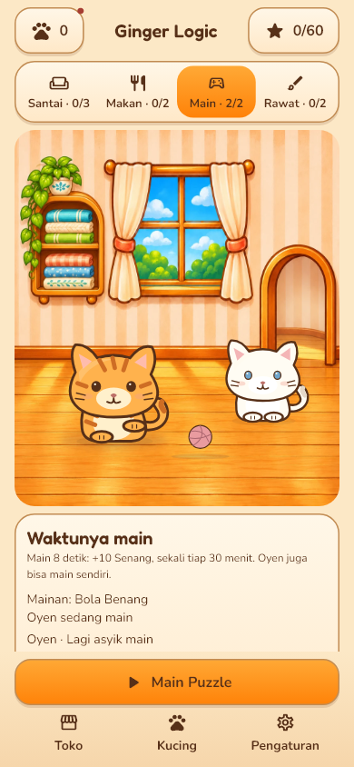
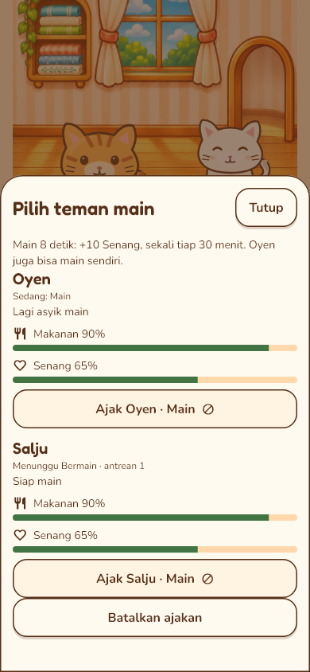
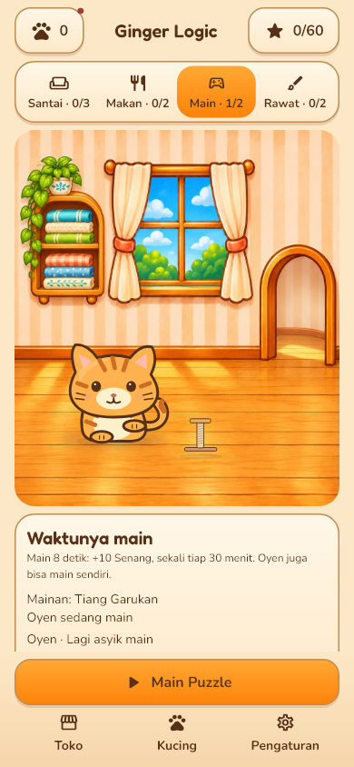
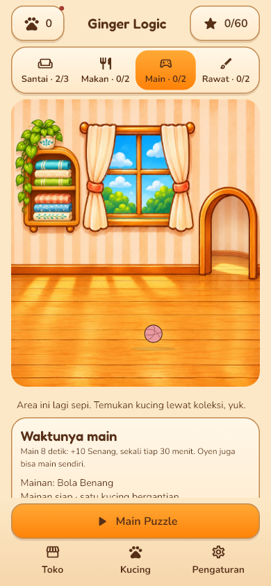
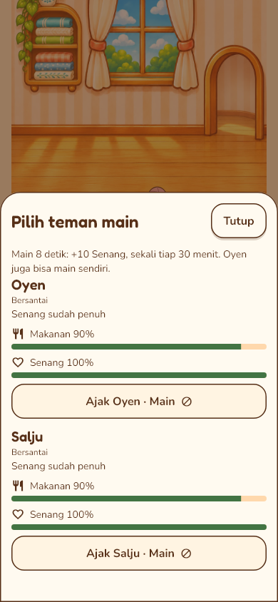
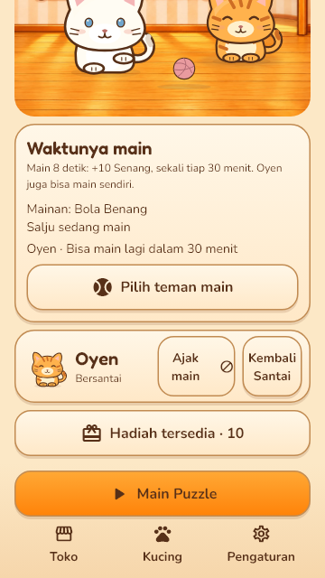

# Tinjauan Area Bermain v2 — langkah 7

10 November 2026. Basis `main` setelah PR #45 (`2de1b6d`), branch
`feat/design-v2-play`. Kontrak tetap SPEC v2: dua kucing, satu bermain dan
satu menunggu; 8 detik aktif, +10 Senang, satu kali per 30 menit per kucing.

## Implementasi

- Bola dasar gratis tanpa transaksi/kepemilikan katalog. Mainan opsional pertama
  menurut urutan katalog dari barang terpasang dipakai sebagai fasilitas.
  Kegiatan aktif mempertahankan ID fasilitas; mengganti mainan tidak membuka
  kuota baru. Menyimpan mainan yang dipakai menginterupsi tanpa efek main.
- `PlayState` membaca kebutuhan, waktu efektif dan antrean scheduler yang sama
  dengan transaksi. Kesiapan, penuh, cooldown, pemakai dan mainan ditampilkan
  pada panel serta sheet pilihan semua kucing. Ajakan ganda dicegah pada UI;
  scheduler tetap memeriksa ulang kelayakan saat memulai dan selesai.
- Main otomatis saat Senang <70; pemain dapat mengajak saat Senang belum penuh
  dan cooldown selesai. Antrean memakai prioritas pemain/FIFO/fairness yang
  sudah ada. Ajakan lain menunggu kegiatan aktif selesai. Tidak ada hadiah
  koin per animasi: klaim gabungan tetap 10/kucing/hari dengan kebutuhan ≥70.
- Satu mainan live terpisah dari latar dan rig, tanpa bola duplikat. Posisi
  bermain/menunggu serta lintasan dua kedalaman mencegah kucing bertumpuk.
  Target mainan dan kucing terpisah, target mainan minimal 48 dp. Kucing yang
  sedang melintas mendapat prioritas ketuk. Kurangi gerak meniadakan transisi
  dan gerak prop; clock/kuota tidak berubah.
- Latar [imagegen bawaan](PAINTED_ASSET.md) mengikuti Makan/Santai. Sumber PNG
  hanya dokumentasi; runtime WebP 1024×1024, decode 4 MiB. Ketiga latar bersama
  maksimal 12 MiB untuk bitmap jika ada di cache; bukan ukuran total proses.
- Pesan area kosong muncul sebelum panel. Kegiatan/simpanan tetap hidup pada
  sheet dan berhenti selama puzzle/background/iklan/gagal simpan.

## Render runtime

Layar kecil dapat digulir; navigasi puzzle tetap di bawah. Tab horizontal
bergeser ke area aktif pada teks besar dan label utuh dapat digulir.

| Bahasa | 360×640, 100% | 360×640, 130% |
| --- | --- | --- |
| Inggris | [render](main-en-360-100.png) | [render](main-en-360-130.png) |
| Indonesia | [render](main-id-360-100.png) | [render](main-id-360-130.png) |
| Portugis Brasil | [render](main-pt-360-100.png) | [render](main-pt-360-130.png) |
| Rusia | [render](main-ru-360-100.png) | [render](main-ru-360-130.png) |

`main-system-*` juga menguji fallback bahasa sistem. Screenshot dibuat dengan
`flutter test test/screens/play_v2_test.dart --dart-define=PLAY_REVIEW=true`.
Seluruh gambar runtime diperiksa, bukan mockup aplikasi.

## Review dan regresi

Review independen menemukan target mainan menutupi kaki kucing. Target sudah
dipisahkan, ukuran 48 dp dan ketidaktumpangtindihan diperiksa di 390/360 px;
mainan dipasang di belakang lapisan kucing untuk prioritas sentuh saat melintas.
Review ulang menyatakan temuan selesai dan tidak ada temuan lain.

Test alur mencakup otomatis, ajakan di atas ambang otomatis, efek hanya sesudah
8 detik, pembatasan 100, cooldown lintas mainan dan tepat kedaluwarsa, antrean,
ketuk ganda, batal, interupsi mainan, hadiah sekali, pause/reload/retry simpan
serta jam mundur. Test widget mencakup bola/mainan katalog, sheet live,
nonaktif saat aktif/penuh, target/lintasan, kurangi gerak dan kembali dari puzzle.

Baseline menemukan test timeout iklan lama tergantung jeda nyata 20 ms antara
`pumpEventQueue` dan callback hadiah. Test itu kini memakai jam virtual widget;
aturan iklan produksi tetap sama. Suite juga menangkap pesan area kosong yang
terdorong panel; pesan dipindahkan mendahului panel, kontrak test dipertahankan.

## Verifikasi akhir

- `dart format lib test`: 272 file, 0 perubahan.
- `flutter analyze`: No issues found.
- `flutter test`: **2.948 lulus**, 135 skip sesuai konfigurasi lama; termasuk
  solver/solusi 20 level dan seluruh regresi rumah/transaksi/puzzle.
- Paket terarah rumah/Makan/Bermain/iklan: **106 lulus**; render runtime
  `PLAY_REVIEW=true` juga berhasil.
- `python tool/translations/make_review.py --check`: sesuai ARB/listing.
- `python tool/art_v2/generate.py --check`: 209 aset vektor sesuai sumber.
- `flutter build apk --debug`: berhasil (assembleDebug 68,9 detik).
  APK lokal: `build/app/outputs/flutter-apk/app-debug.apk`; berkas build
  tidak masuk Git. SHA-256:
  `78fc75779524e1549d6c41bd4110f4cac60be2a763c510641b0c7a85e6ea5fee`.
- `measure_apk.py`: 214 entry paket art, 720.695 byte mentah / 507.916 byte
  terkompresi; latar Bermain 127.572 byte. Sumber PNG tidak dibundel.
- Tautan dokumentasi lokal dan `git diff --check`: valid.

## Batas

Pemeriksaan host Flutter dan render statis; belum sesi manual HP, TalkBack,
profil frame/memori/perangkat rendah atau penerimaan visual pemilik repo untuk
area baru. Profil menyeluruh tetap langkah 13/15. Editor pilihan/penempatan
mainan tetap langkah 9. Screenshot ini bukti runtime pengembangan, bukan materi
toko final. Tidak ada perubahan simulator, level, harga, kuota atau snapshot.
